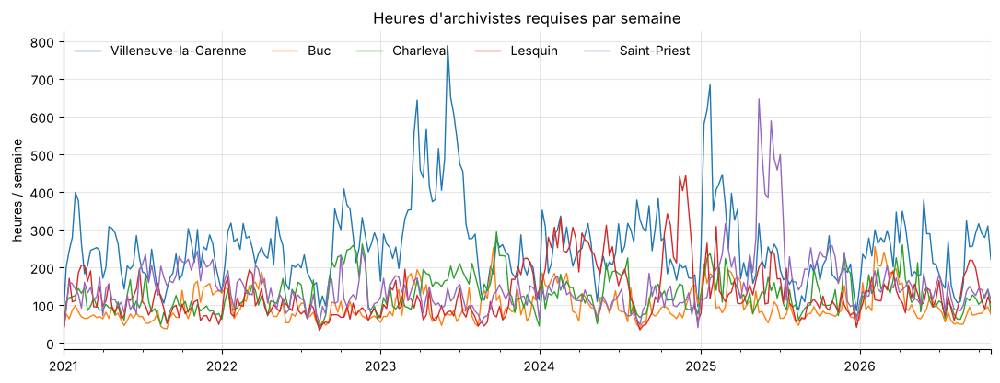
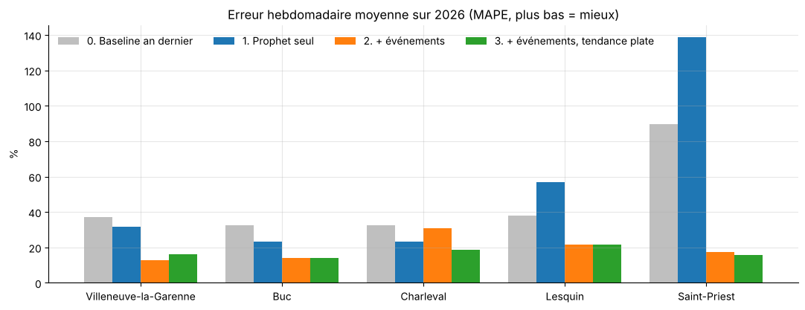
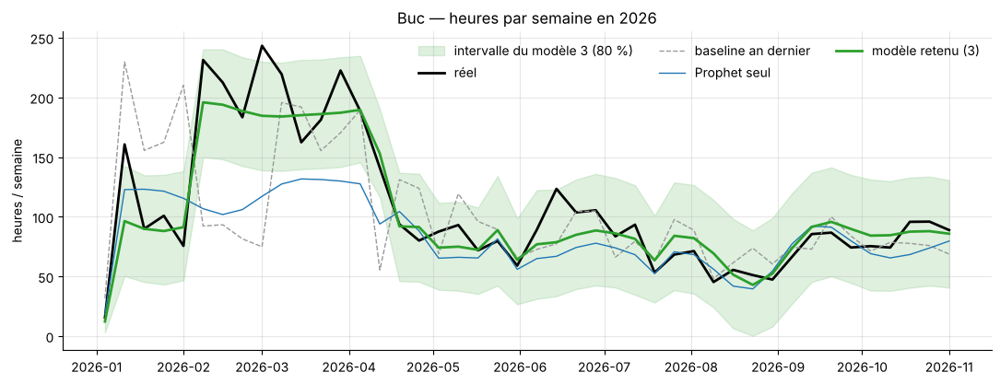
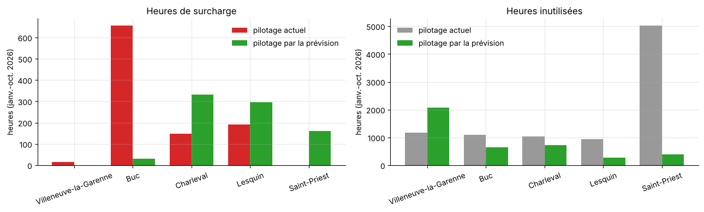
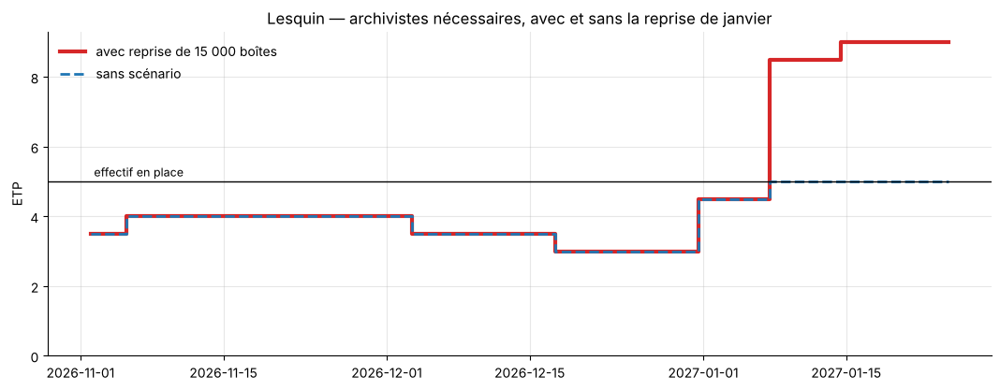

# Prévoir la charge des archivistes pour dimensionner les équipes

Projet de forecasting de séries temporelles avec **Prophet**. Il porte sur un cas concret : la charge de
travail des archivistes d'un tiers-archiveur, site par site, pour savoir à l'avance quand renforcer une
équipe et quand elle a de la marge.

> ⚠️ **Toutes les données sont simulées.** Le contexte reprend le fonctionnement type d'un tiers-archiveur
> (société qui conserve les archives papier d'autres organisations), mais l'entreprise, les clients, les
> volumes et les effectifs sont fictifs. Le générateur et ses hypothèses sont dans ce dépôt.

## Pourquoi ce projet

Dans un centre d'archives, la charge de travail ne se lisse pas. Un contrat signé en janvier peut amener
30 000 boîtes à reprendre en mars. Un contrôle fiscal chez un client déclenche des centaines de demandes de
consultation en deux semaines. En août, l'activité chute de moitié. Pourtant, les effectifs sont souvent
fixés une fois par an, d'après l'année écoulée.

Je suis data analyst, spécialisé en BI depuis cinq ans (Power BI, SQL Server, Python). Une partie de ce
parcours s'est faite chez un tiers-archiveur : j'y ai mené la migration du reporting de SSRS vers Power BI
et construit un entrepôt de données SQL Server centralisé. Je connais donc ce métier par ses données :
les flux de boîtes, les clients, les sites. J'ai aussi fait de la modélisation prédictive (régression,
segmentation K-means) dans un poste précédent. Ce projet y ajoute les séries temporelles, sur un sujet
dont je comprends les enjeux opérationnels.

L'objectif était de mesurer ce qu'un modèle de prévision simple, et surtout explicable, peut apporter à ce
pilotage. Pas un modèle de recherche, mais un outil qu'un responsable de site peut lire, comprendre et
utiliser pour décider d'un renfort ou accepter des congés.

Faute de données publiques sur le sujet, le jeu de données a été construit de zéro. Ce choix oblige à
expliciter chaque hypothèse métier (temps de traitement d'une boîte, saisonnalité par type de client,
rythme d'une reprise de fonds) au lieu de la subir, et chacune reste modifiable dans le générateur.

Ce que le projet montre :
- partir d'une décision métier (combien de personnes, et quand) plutôt que d'une métrique abstraite ;
- évaluer un modèle honnêtement : baseline, test sur une année jamais vue, validation croisée ;
- traduire une prévision en indicateurs qui parlent à un manager : ETP, heures de surcharge, semaines
  d'alerte.

---

## Le problème

Chaque jour, les archivistes d'un site traitent cinq types de mouvements : versements de nouvelles boîtes,
consultations, retours, destructions en fin de durée de conservation, et restitutions quand un client part.
Chaque mouvement a un coût en temps, et c'est la somme de ces heures que l'on cherche à prévoir.

Dans la simulation, chaque site fixe son effectif une fois par an, d'après la charge moyenne de l'année
précédente. Résultat : des équipes débordées pendant une reprise de fonds pourtant signée à l'avance, et
d'autres en sureffectif toute l'année après un pic ponctuel.

**La question :** peut-on prévoir, plusieurs semaines à l'avance, les heures de travail nécessaires sur
chaque site, et en déduire le bon nombre d'archivistes ?

## La démarche

| Étape | Fichier | Contenu |
|---|---|---|
| 1. Données | `generate_dataset.py` | 5 sites, environ 500 clients, 2021 → oct. 2026 au jour près ; modèle en étoile (9 CSV) |
| 2. Exploration | `notebooks/01_exploration.ipynb` | Qualité des données, composition de la charge, saisonnalités, effet des événements |
| 3. Modélisation | `notebooks/02_prophet.ipynb` | Baseline, 3 variantes de Prophet, validation croisée sur 15 périodes |
| 4. Effectifs | `notebooks/03_effectifs.ipynb` | Heures → ETP, fiabilité des alertes, pilotage actuel vs prévision, plan à 3 mois |

Le détail des choix, des itérations et des limites est dans [`DOCUMENTATION.md`](DOCUMENTATION.md).
Le dictionnaire des données et les hypothèses du générateur sont dans [`data/README.md`](data/README.md).



## Résultats

### 1. Ce qui compte, ce sont les événements connus à l'avance

Prophet utilisé seul confond une reprise de fonds ponctuelle avec une tendance de fond, et la prolonge.
Dès qu'on lui donne les arrivées et départs de clients signés (en régresseur), l'erreur est divisée par deux.

| Modèle | Erreur hebdo moyenne (validation croisée, horizon 8 semaines) |
|---|---|
| Baseline « même jour l'an dernier » | 41,5 % |
| Prophet seul | 36,2 % |
| Prophet + événements connus | 17,8 % |
| **Prophet + événements, tendance plate** | **16,6 %** |



La version retenue utilise une **tendance plate** : les changements de niveau viennent des événements, pas
d'une pente que le modèle extrapolerait. C'est plus robuste sur 4 sites sur 5. En contrepartie, un site en
croissance régulière serait sous-estimé.



*À Buc, la reprise de février-avril 2026 est anticipée dès le 1er janvier. Prophet seul et la baseline
ne la voient pas venir.*

### 2. Traduit en effectifs

Si l'effectif avait été piloté chaque mois par la prévision plutôt que fixé sur l'année précédente
(janvier-octobre 2026, 5 sites) :

| | Pilotage actuel | Par la prévision |
|---|---|---|
| Heures payées | 40 726 | 35 766 (−12 %) |
| Heures de surcharge | 1 008 | 819 |
| Heures inutilisées | 9 273 | 4 123 |



Le gain n'est pas uniforme. Il est net à Buc (surcharge évitée) et à Saint-Priest (sureffectif résorbé).
Il est légèrement négatif à Charleval et à Lesquin, où le modèle sous-estime un peu la charge.

### 3. Un outil de planification

Le notebook 03 produit un plan semaine par semaine pour les 3 mois à venir, avec l'écart en ETP pour chaque
site. On peut y saisir une reprise signée et voir immédiatement combien de personnes il faudra, et à
partir de quand.



## Limites

- Les données sont simulées : les temps standards par boîte, les taux de consultation et les règles de
  présence sont des hypothèses, pas des mesures.
- Le gain de 12 % dépend de la règle de dimensionnement « actuelle », elle-même simulée. Il illustre une
  méthode, il ne mesure pas un résultat réel.
- Les pics imprévus (contrôles fiscaux, audits clients) restent hors de portée du modèle, par construction.
- Ajuster un effectif chaque mois a un coût (recrutement, formation d'intérimaires) que le calcul ignore.

La liste complète est dans [`DOCUMENTATION.md`](DOCUMENTATION.md#7-limites-connues).

## Lancer le projet

Python 3.13, testé sous Windows.

```
git clone https://github.com/Bahimer/forecast-archivage.git
cd forecast-archivage
python -m venv .venv
.venv\Scripts\activate          # macOS / Linux : source .venv/bin/activate
pip install -r requirements.txt
python generate_dataset.py      # génère les CSV dans data/ (quelques secondes)
```

Ouvrir ensuite les notebooks dans l'ordre (01, 02, 03), dans VS Code ou Jupyter. Le notebook 02 écrit les
prévisions dans `outputs/`, que le notebook 03 réutilise.

## Arborescence

```
├── generate_dataset.py      # générateur de données (seed fixe, reproductible)
├── data/
│   └── README.md            # dictionnaire des données et hypothèses
├── notebooks/
│   ├── 01_exploration.ipynb
│   ├── 02_prophet.ipynb
│   └── 03_effectifs.ipynb
├── outputs/                 # prévisions, scores, plans d'effectifs (CSV)
├── docs/img/                # graphiques du README
├── DOCUMENTATION.md         # journal de travail : choix, itérations, limites
└── requirements.txt
```

## Stack

Python · pandas · Prophet · matplotlib · Jupyter
